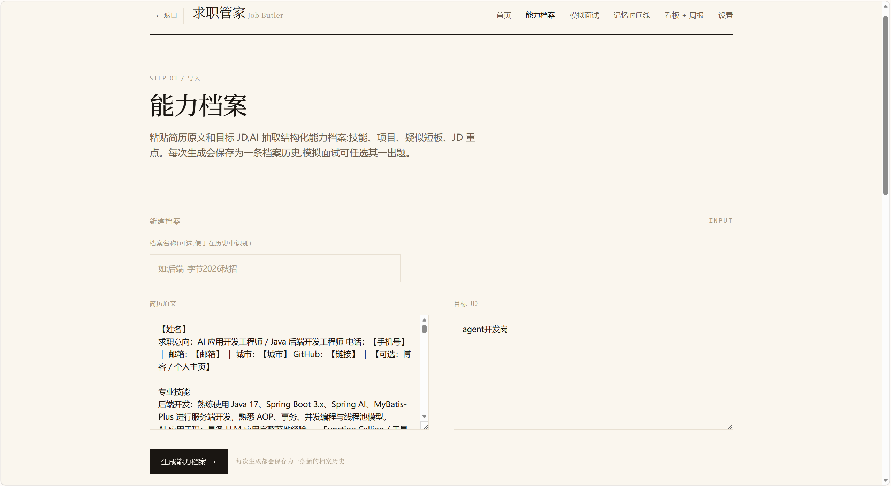
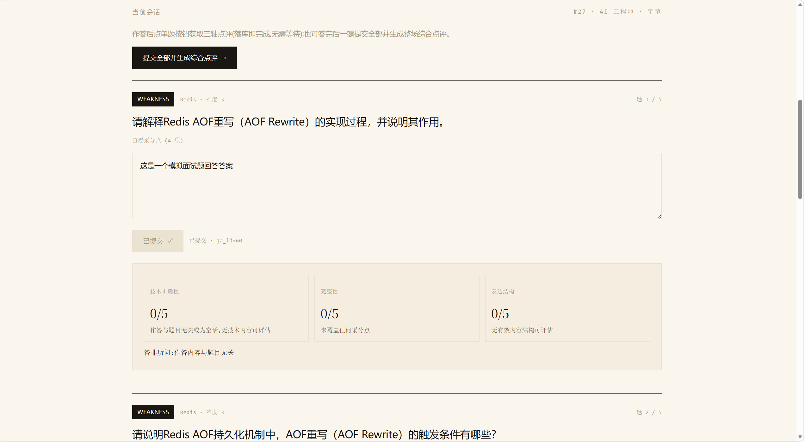
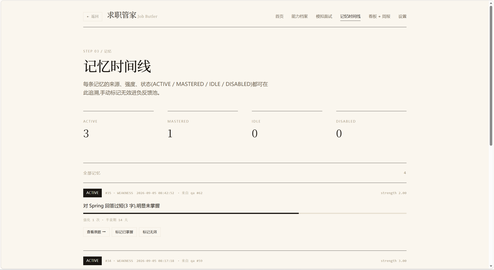
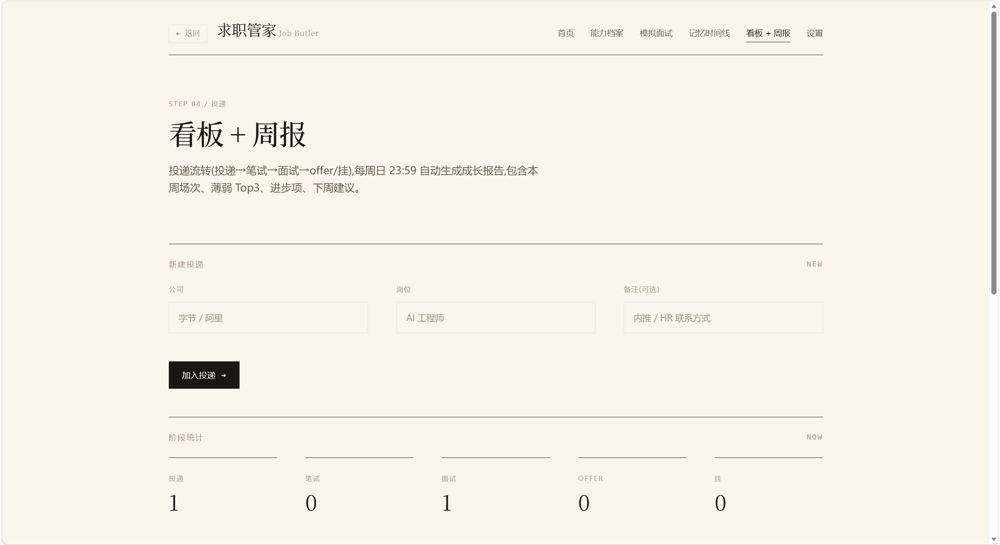
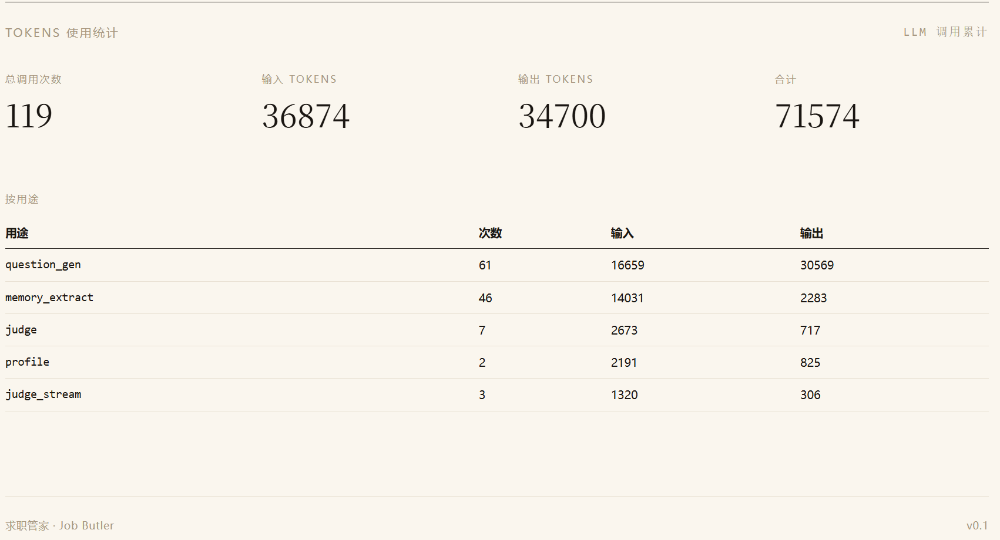

# 求职管家 · Job Butler

[](https://www.python.org/)
[](https://fastapi.tiangolo.com/)
[](https://www.sqlite.org/wal.html)
[](#mcp-集成)
[](LICENSE)

> 会长期记住你的 AI 求职伙伴：把答错的知识点沉淀成记忆，在下一场面试里主动再训练，并按遗忘曲线自动衰减。

求职管家是一个本地运行的 AI 面试陪练：导入简历与目标 JD 生成能力档案，进行模拟面试并获得逐题三轴点评；暴露出的弱点会自动沉淀为记忆，在后续出题中优先覆盖。投递进展用看板管理，每周生成成长报告，记忆库同时通过 MCP 向 IDE Agent 开放。

## 目录

- [功能特性](#功能特性)
- [界面预览](#界面预览)
- [技术栈](#技术栈)
- [快速开始](#快速开始)
- [配置](#配置)
- [MCP 集成](#mcp-集成)
- [系统架构](#系统架构)
- [测试与实验](#测试与实验)
- [License](#license)

## 功能特性

- **能力档案** —— 粘贴简历与 JD，LLM 抽取技能、JD 重点、疑似短板与项目，保存为可命名的档案历史，支持回看与删除。
- **模拟面试** —— 按所选档案与岗位并行生成题目（默认 5 题：弱点 2 / 简历 2 / 新知 1），避开近 30 天已出题目；逐题 SSE 流式三轴点评（技术正确性 / 完整性 / 表达结构），结束后一键生成整场综合点评；历史会话可回看与删除。
- **认知记忆引擎** —— 从作答与点评中抽取具体知识点弱点，经质量门、相似合并、半衰期衰减与状态机管理；开启记忆时，弱点会成为下一场 WEAKNESS 槽的题源。
- **记忆时间线** —— 查看记忆强度、状态与来源题目，手动标记无效 / 已掌握 / 恢复活跃。
- **投递看板与周报** —— 投递 / 笔试 / 面试 / offer / 挂五阶段流转；服务运行期间每周日 23:59 自动生成周报，也可手动生成与删除。
- **MCP 与 HTTP 接口** —— 通过 stdio MCP 或 HTTP 端点向 IDE Agent 暴露记忆检索、记忆简报与档案概要。
- **多厂商接入与用量统计** —— 统一走 OpenAI 兼容协议，支持 vLLM / DeepSeek / OpenAI / Kimi / 智谱 / 通义 / 自定义；设置页按用途统计 token 用量。
- **界面偏好** —— 暖白 / 纯黑双主题，字号与密度可调，偏好保存在浏览器本地。

## 界面预览

| **能力档案** —— 粘贴简历 + JD，AI 抽取 4 维结构化档案 | **模拟面试 · 三轴点评** —— 逐题流式点评，分数可解释 |
|---|---|
|  |  |

| **记忆时间线** —— 弱点记忆自动沉淀，状态机可视 | **看板 + 周报** —— 投递流转 + 每周成长报告 |
|---|---|
|  |  |

| **Tokens 使用统计** —— 按用途累计的 LLM 调用面板 | |
|---|---|
|  | |

## 技术栈

| 层 | 选型 | 说明 |
|---|---|---|
| Web | FastAPI + Jinja2 + HTMX | 服务端渲染；点评通过 SSE 流式输出 |
| LLM | OpenAI 兼容协议 | 本地 vLLM，或 DeepSeek / OpenAI / Kimi / 智谱 / 通义 / 自定义 |
| Embedding | `bge-small-zh-v1.5`（512 维） | 走 OpenAI 兼容的 embeddings 端点 |
| 存储 | SQLite（WAL） | 9 张业务表；WAL + 单写者锁 |
| 记忆 | BLOB + numpy 余弦 | 相似合并、半衰期衰减、状态机 |
| 调度 | APScheduler | 每周日 23:59（`Asia/Shanghai`）生成周报 |
| MCP | FastMCP / MCPServer | 3 个工具；同时提供 HTTP 查询端点 |

## 快速开始

### 前置

- Python 3.10+ 与 [uv](https://docs.astral.sh/uv/)
- 一个 OpenAI 兼容的 LLM 端点（本地 vLLM，或 DeepSeek / OpenAI / Kimi / 智谱 / 通义等云 API）
- 一个 OpenAI 兼容的 Embedding 端点，默认按 `bge-small-zh-v1.5`（512 维）配置；没有 embeddings 接口的云厂商需要另配端点

### 安装与启动

```bash
cd job_butler
uv sync
uv run uvicorn app.main:app --host 127.0.0.1 --port 8803
```

打开 <http://localhost:8803>。

> 只绑定 `127.0.0.1`。应用没有登录鉴权，绑定 `0.0.0.0` 会让同一网络内的任何人读取简历、档案与设置。

### 首次使用

1. **`/settings`** —— 选择厂商预设，填写 LLM 与 Embedding 的 Base URL / API Key，保存后下一次请求生效。
2. **`/profile`** —— 粘贴简历与目标 JD，命名并生成能力档案。
3. **`/interview`** —— 选择档案开始新面试，逐题作答；答完用「提交全部并生成综合点评」结束整场。
4. **`/timeline`** —— 查看自动抽取的弱点记忆；**`/kanban`** —— 管理投递并生成周报。

应用数据保存在本地 SQLite（默认 `data/job_butler.db`）。使用云厂商时，简历、JD 与作答内容会发送到所配置的 LLM / Embedding 端点。

## 配置

环境变量只影响首次运行的默认值；设置页或已持久化的 `settings` 值优先。应用不会自动加载 `.env`；可复制 `.env.example` 为 `.env` 后用 `uv run --env-file .env ...` 启动，或直接在启动进程中设置环境变量。改环境变量不生效时，在设置页修改或调用 `POST /api/settings/reset` 重置。

| 变量 | 说明 | 默认 |
|---|---|---|
| `JOB_BUTLER_DB` | SQLite 路径 | `data/job_butler.db` |
| `LLM_PROVIDER` | 厂商预设：`vllm` / `deepseek` / `openai` / `moonshot` / `zhipu` / `dashscope` / `custom` | `vllm` |
| `VLLM_BASE_URL` / `VLLM_MODEL` / `VLLM_API_KEY` | LLM 端点 / 模型 / Key | `http://localhost:8000/v1` / `qwen3-4b-awq` / `EMPTY` |
| `EMBED_BASE_URL` / `EMBED_API_KEY` | Embedding 端点 / Key | `http://localhost:8001/v1` / `EMPTY` |

在 `/settings` 还可以修改温度、超时、思考模式、每场题数与配比、记忆阈值等。真实 API Key 回显为 `****` 加末 4 位，占位值 `EMPTY` 原样显示；不修改则保留原值。完整默认值与厂商预设见 [架构文档 · 配置与模型接入](docs/ARCHITECTURE.md#配置与模型接入)。

## MCP 集成

stdio 方式（Cursor / Claude Desktop 等）：

```json
{
  "mcpServers": {
    "job-butler": {
      "command": "uv",
      "args": [
        "--directory", "/path/to/job_butler",
        "run", "python", "-c",
        "from app.mcp_server import run_stdio; run_stdio()"
      ],
      "env": { "JOB_BUTLER_DB": "/path/to/job_butler/data/job_butler.db" }
    }
  }
}
```

三个工具：

- `memory_search(query, k=5, status="ACTIVE")` —— 关键词过滤 + 强度排序；`status=None` 表示全部状态
- `memory_brief(top_n=5)` —— 各状态计数 + 活跃弱点 Top N
- `profile_get(limit=5)` —— 最近 N 条档案的技能、JD 重点、疑似短板与项目

服务启动后也可直接用 HTTP 查询：

```bash
curl "http://127.0.0.1:8803/api/mcp/memory/brief?top_n=5"
curl "http://127.0.0.1:8803/api/mcp/memory/search?q=Redis&k=5&status=ACTIVE"
curl "http://127.0.0.1:8803/api/mcp/profile/get?limit=5"
```

## 系统架构

```
浏览器（Jinja2 + HTMX，SSE）
        │ HTTP
        ▼
FastAPI 单进程
├── 页面路由与 JSON API
├── 档案 / 面试 / 记忆 / 看板 / 周报 / 设置
├── LLM 任务：档案抽取 / 三轴点评 / 出题 / 综合点评
└── MCP：stdio 三工具 + HTTP 包装

        │                          │
        ▼                          ▼
SQLite（WAL、单写者锁）      OpenAI 兼容 LLM / Embedding
```

- **请求链路**：档案解析 → 三槽并行出题 → SSE 逐题点评 → 落库后后台抽取记忆 → 综合点评 / 周报。
- **记忆闭环**：抽取 → 质量门 → 相似合并 → 半衰期衰减 → 状态机；WEAKNESS 槽只取 ACTIVE 记忆。
- **降级**：出题失败回退题库，记忆抽取回退规则，SSE 失败推送 `error` 事件。

完整模块边界、数据流、9 张表与运行约束见 [docs/ARCHITECTURE.md](docs/ARCHITECTURE.md)。

## 测试与实验

验收脚本 `test_w1`~`test_w4` 使用独立临时库，不会写入 `data/job_butler.db`：

```bash
uv run python tests/test_w1.py
uv run python tests/test_w2.py --skip-slow
uv run python tests/test_w3.py
uv run python tests/test_w4.py
```

各脚本的覆盖范围见 [架构文档 · 测试与实验](docs/ARCHITECTURE.md#测试与实验)。部分用例会调用真实 LLM / Embedding 端点，运行前请确保端点可达；`--skip-slow` 可跳过部分慢用例。

A/B 实验脚本会清空目标库中的记忆、作答与会话；未设置 `JOB_BUTLER_DB` 时目标库就是 `data/job_butler.db`。运行前请显式指定一个临时库：

```bash
JOB_BUTLER_DB=data/ab_report.db uv run python tests/ab_report.py
```

A/B 实验（记忆开关各 20 场，弱点槽共 80 题）：记忆开启后，WEAKNESS 槽命中预设弱点的比例从 **0%** 提升到 **100%**，覆盖 Redis / MySQL / Kafka / Spring / JVM / Agent / CAP 七个领域。完整报告见 [data/ab_report.md](data/ab_report.md)。

## License

本项目基于 [MIT License](LICENSE) 开源，详见根目录 `LICENSE` 文件。
